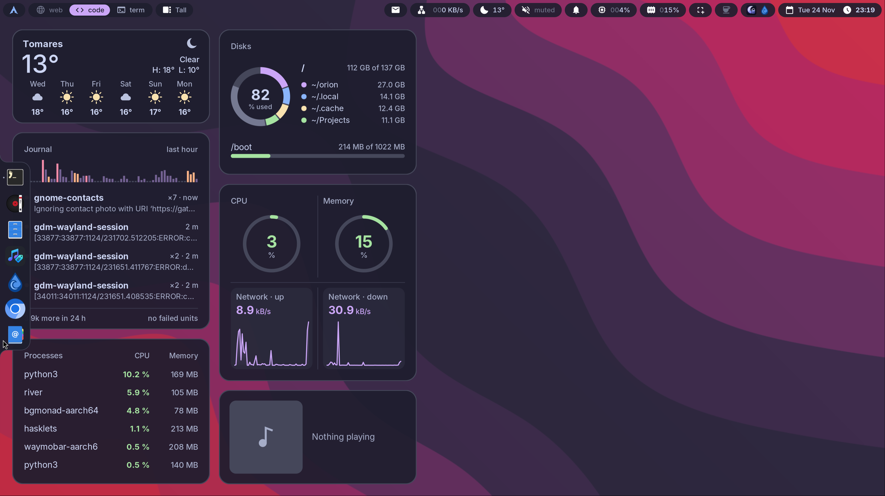

# docklet

A dock for [river](https://codeberg.org/river/river) +
[rivermonad](https://github.com/prietus/rivermonad): the applications that
are running and the ones you pinned, in a tab that grows out of an edge of
the screen, like [waymobar](https://github.com/prietus/waymobar)'s attached
side panel (or in a pill floating beside the edge, like the bar's).



- it is **hidden**: push the pointer against the edge and it slides out,
  and it goes away a moment after the pointer leaves it (or it can stay
  there, and the windows make room for it);
- **click** an icon to go to the application's window (again: its next
  window), or to start it when it is not running;
- **middle click** opens a new window of it;
- **right click** opens a menu: its windows, a new window, the actions of
  its desktop file (a private window...), **pin it to the dock** or unpin
  it, close it;
- **drag** an icon onto another to reorder the pinned ones (dragging one
  that is not pinned pins it there).

Pinned applications come first, then the other running ones after a line.
An icon has a dot per window (three at most); the focused application is
lit in mauve. Minimised windows count; scratchpads waiting out of sight
do not.

## Use

    docklet            start the dock (it stays running)
    docklet toggle     show it now, or hide it again
    docklet quit       stop it

Start it with the session, in `rivermonad.hs`:

```haskell
  , startupHook = spawnOnce "docklet"
```

and, if you like, show it from the keyboard:

```haskell
  , ("M-d", spawn "docklet toggle")
```

## Install

Arch Linux: [docklet](https://aur.archlinux.org/packages/docklet) in the
AUR (`packaging/arch/PKGBUILD`). By hand:

    pacman -S python-gobject gtk4 gtk4-layer-shell
    git clone https://github.com/prietus/docklet ~/docklet
    ln -s ~/docklet/docklet ~/.local/bin/docklet

Needs rivermonad 0.4.3 or newer (its IPC lists every window).

## Settings

`~/.config/docklet/config.json` (see `examples/config.json`); every key is
optional. Restart docklet after changing it.

| Key | Default | |
|---|---|---|
| `position` | `"left"` | `"left"`, `"right"`, `"bottom"` or `"top"` |
| `autohide` | `true` | `false`: always there, and the windows make room for it |
| `icon_size` | `40` | logical pixels |
| `attached` | `true` | joined to the edge, flaring out with inverted corners where it meets it; `false`: a pill floating beside the edge |
| `margin` | `6` | floating: between the dock and the edge of the screen |
| `show_delay` | `150` | milliseconds the pointer rests at the edge before it opens |
| `hide_delay` | `400` | milliseconds after the pointer leaves it before it closes |
| `slide` | `200` | milliseconds it takes to slide in; 0 = no animation |
| `corner_gap` | `100` | the edge does not open it this close to the corners (they are for hot corners) |
| `pinned` | `[]` | desktop file IDs, in order |

docklet writes `pinned` itself when you pin, unpin or reorder; the rest of
the file is kept as it is.

`~/.config/docklet/style.css` restyles it (GTK CSS, loaded after the
built-in style). The window has the class `docklet`, the pill `dock`, an
icon `item` (`focused`, `launching`), its dots `dot`; menus and labels are
`popover.docklet-pop`. The attached tab is drawn, in two named colours:

```css
@define-color docklet_tab_bg rgba(49, 50, 68, 0.97);
@define-color docklet_tab_border #585b70;
```

and the floating pill is a CSS box:

```css
.docklet .dock { background-color: rgba(49, 50, 68, 0.9); border: 1px solid #45475a; }
```

## How windows find their application

By the window's app id: the desktop file of that name, the one whose
`StartupWMClass` is that app id, the one named like its last part
(`org.mozilla.firefox`: `firefox.desktop`) or ending in it, or the one
whose command it is. A window without a desktop file still gets an icon
(the one named like its app id, if the theme has it) and can be pinned:
it is started by running its app id.

## License

BSD 3-Clause, see [LICENSE](LICENSE).
